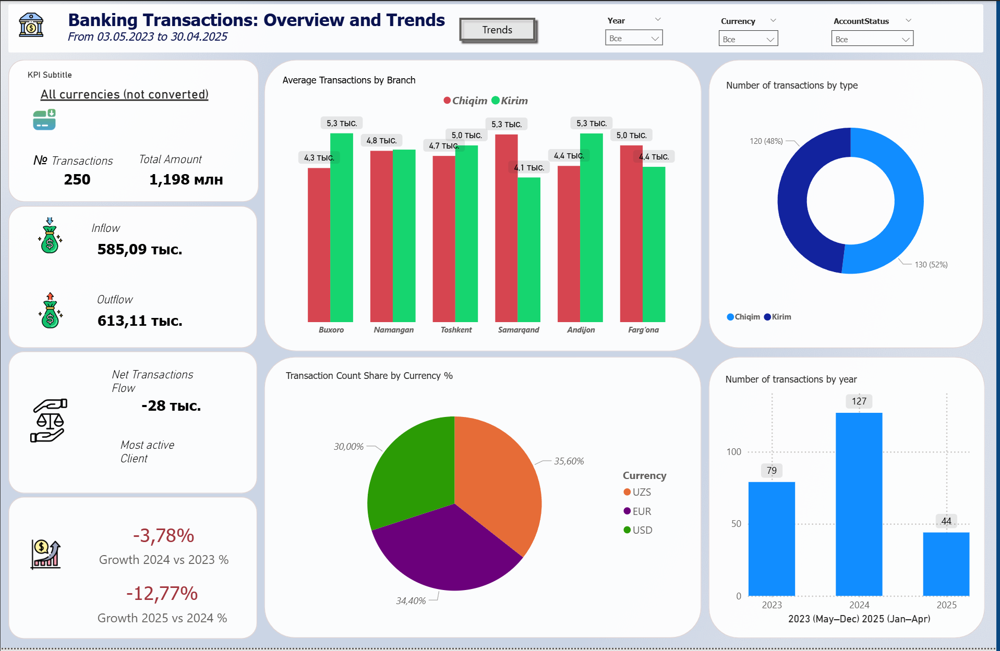
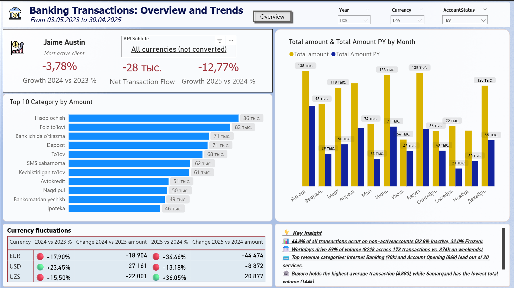

# Анализ мультивалютных банковских транзакций

## О проекте
Исследование денежного потока на основе выборки из 250 банковских операций в трёх валютах (**UZS, USD, EUR**). Цель проекта — структурировать доходы и расходы, отследить динамику трендов и выявить причины отрицательного денежного потока.

## Стек технологий
* **Power BI** — проектирование модели данных и интерактивная визуализация.
* **DAX** — создание кастомных мер для расчёта оборотов, баланса и структуры расходов.
* **Power Query** — очистка данных, преобразование типов и нормализация категорий операций.

## Этапы работы
1. **Подготовка данных (Power Query):**
   * Стандартизированы категории доходов и расходов по 250 транзакциям.
   * Настроена корректная обработка мультивалютных счетов (UZS, USD, EUR).
2. **Расчёт KPI и визуализация (DAX & Power BI):**
   * Написаны DAX-меры для расчёта поступлений, списаний, чистого денежного потока (Net Cash Flow) и доли каждой категории затрат.
   * Созданы две страницы отчёта: сводный обзор показателей и анализ трендов по периодам.

## Ключевые выводы
* **Валютный дисбаланс:** при положительном остатке и притоке средств в **USD** и **EUR**, общий денежный поток оказался отрицательным из-за высокой доли регулярных расходов в **UZS**.
* Визуализация позволила выделить основные статьи расходов в сумах, формирующие наибольшую нагрузку на баланс.

## Скриншоты дашборда
### Главная страница (Обзор KPI)

### Вторая страница (Динамика и тренды)

## Содержимое репозитория
* `Bank Transactions.pbix` — файл интерактивного отчёта Power BI.
* `Bank_Transactions_.xlsx` — исходный набор данных.
* `dashboard_main.png` и `dashboard_details.png` — скриншоты страниц дашборда.
